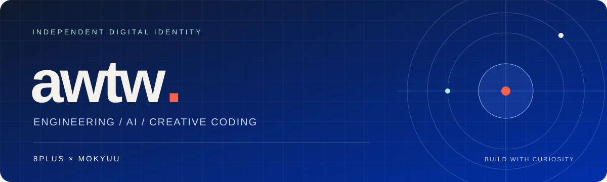

  

# 嗨，我是 awtw。

**把想法寫成程式，把觀點做成作品。**

全端開發 · AI 應用 · 介面設計 · 互動創作

[探索 8plus ↗](https://www.8plus.app/)　 ·　 [走進墨語 MOKYUU ↗](https://mokyuu.com/)

 

### 01 / 關於這個數位身份

我是 **awtw**，一個在工程、設計與創作之間探索的開發者。喜歡把複雜問題整理成清楚的流程，再做成容易使用、能持續維護的產品。

這裡收錄我的程式實作與探索。透過 **8plus** 分享技術與實務，透過 **墨語 MOKYUU** 表達觀點、故事與互動創作；兩個入口，都是認識我的方式。

 

### 02 / 從這兩個地方開始

<table>
<tr>
<td width="50%" valign="top">

#### 8plus
**工程 × AI × 產品體驗**

把技術想法推進到實際應用的工作室。聚焦 AI 應用、系統整合與 UI/UX，分享專案作品、技術文章與合作服務。

適合想看 **實作成果、技術思考，或討論專案合作** 的你。

**[探索 8plus →](https://www.8plus.app/)**

</td>
<td width="50%" valign="top">

#### 墨語 MOKYUU
**數位人格 × 觀點 × 互動作品**

讓創意與個性自由生長的空間。透過網頁小遊戲、互動實驗、故事與創作手記，記錄我怎麼看世界、想創造什麼。

適合想 **玩玩作品、閱讀手記，或認識我的創作面貌** 的你。

**[走進墨語 →](https://mokyuu.com/)**

</td>
</tr>
</table>

 

### 03 / 我關注的事

| 方向 | 我在意的細節 |
| :--- | :--- |
| **AI 與自動化** | RAG、AI Agent、資料流程與評測，讓 AI 能融入實際工作。 |
| **全端與系統整合** | 從介面、API 到部署，兼顧架構清晰、穩定性與可維護性。 |
| **設計與互動** | 資訊層次、易用性與視覺節奏，讓產品好懂，也有自己的個性。 |

<b>常用工具與技術</b>

 

- **前端** · TypeScript / Vue / Next.js
- **後端** · .NET / Python / Node.js
- **實作方向** · API 整合 / AI 應用 / 工作流程自動化 / 互動網頁

工具隨問題選擇；清楚的需求與細緻的體驗，是我做作品的起點。

 

---

**想一起做點有意思的事？**

技術與專案合作，從 [8plus](https://www.8plus.app/) 開始。 
創作與靈感交流，歡迎走進 [墨語 MOKYUU](https://mokyuu.com/)。

awtw · 持續實作，保持好奇。

